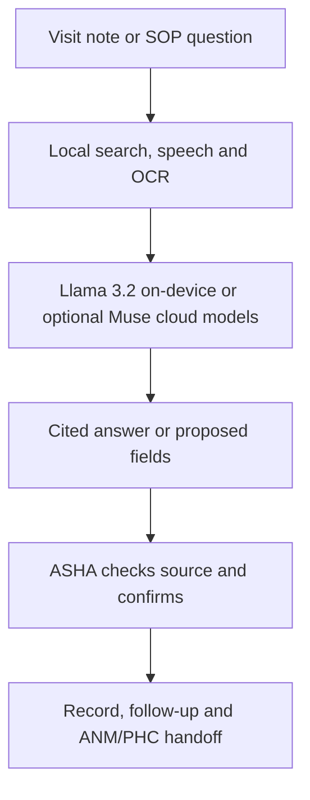

<p align="center"></p>

<h1 align="center">Pramaan</h1>

<p align="center"><strong>An offline-first AI co-worker for India's ASHA community health workers.</strong><br>
Ask an official SOP. See the exact source and page. Turn a home visit into accountable follow-up — even without a mobile signal.</p>

<p align="center">
  
  
  
  
</p>

> **Hackathon prototype — fictional records only.** Pramaan supports trained frontline workers; it is not a diagnostic device, does not replace clinical judgment, and is not approved for live patient records. The demo people and records are synthetic.

| Explore | Link or status |
|---|---|
| 🎬 **Three-minute demo** | **Coming soon — video in production** |
| 📱 **Android APK** | **Release pending final installation test** — [Releases](https://github.com/ektasikka1989-cmyk/Pramaan/releases) |
| 📚 **Models and setup** | [MODELS.md](MODELS.md) · [Hugging Face model pack](https://huggingface.co/datasets/EktaSikka/Pramaan_Meta_Models) (availability/download to be verified) |
| 🔒 **Data handling** | [PRIVACY.md](PRIVACY.md) |
| 🏆 **Entry** | Meta Global AI Developer Hackathon 2026 · Build for Your World · Ekta Sikka |

## The problem: one frontline worker, hundreds of decisions

India has roughly **ten lakh ASHAs** working at the last mile of community healthcare. The commonly cited planning norm is approximately **one ASHA per 1,000 rural residents**, although actual workloads vary. For families depending on her, a missed immunisation follow-up, an unrecorded pregnancy visit or a delayed referral can matter. Across lakhs of workers, small improvements in everyday work could benefit **many lakhs of people**; this is the potential reach, **not a measured outcome** of Pramaan.

Her challenge is not simply answering a medical question:

1. **Guidelines keep growing and changing.** ASHAs work with hundreds of pages of training modules, SOPs, programme instructions and updates, often in different languages. Finding the applicable paragraph during a visit is difficult; checking whether an action agrees with it is harder.
2. **Work is fragmented.** A single home visit can involve an MCP card, HBNC/HBYC or ANC form, village and immunisation registers, stock entries, a referral and the next visit date. Duplicate writing makes missed entries and follow-ups more likely.
3. **The family needs an explanation.** The worker must convert technical guidance into understandable Hindi or another local language, while making clear when a clinician or ANM is needed.
4. **Handoffs need evidence and accountability.** An ANM or PHC needs a usable summary of what was observed, done, referred and left pending — not a disconnected pile of notes. A record of completed and due actions helps the worker review her own work too.
5. **Connectivity cannot be assumed.** In a village without a signal, a cloud-only chatbot cannot reliably support a visit.

**Pramaan's answer:** a source-citing **Ask SOP** assistant connected to a visit workflow, rather than a general chatbot. It helps the ASHA find guidance, inspect the evidence, capture a visit, review suggested entries, update records, track pending work, and prepare a summary for the ANM or PHC. The worker remains responsible for confirmation and escalation.

## The signature feature: Ask SOP — guidance with proof

Ask a question in **Hindi, English or Hinglish** — for example, *“What newborn danger signs require urgent referral?”* Pramaan searches its locally stored government-guide knowledge base and presents:

- a concise, task-relevant response;
- the **source document, specific page and supporting passage** so the ASHA can check what the guidance actually says;
- access to the underlying PDF when available, plus follow-up questions;
- an optional **Check online** route for eligible cloud use, clearly distinguished from the offline source answer.

This is more than a citation pasted beneath an AI reply: the intended workflow is **ask → inspect source → decide with professional judgment → record action → review follow-up**. A citation makes verification possible; it **does not guarantee that an answer is clinically correct**. Current local content must be updated when official guidance changes.

## From one visit to an accountable workflow

| At the doorstep | What Pramaan helps do | What stays traceable |
|---|---|---|
| **Plan** | See due ANC, HBNC, HBYC, immunisation and missed visits | Person, visit type, due date, pending tasks |
| **Capture** | Speak a Hindi/English note; read a slip or MCP card photo; suggest fields for the relevant form | Proposed values and their supporting note or extracted text |
| **Verify** | Ask SOP with document/page citation; review fixed-rule danger-sign prompts | Source reference, worker review, referral decision |
| **Explain** | Prepare family-friendly instructions in accessible language | Guidance the worker chooses to communicate |
| **Record** | Confirm and save to linked visit forms, digital MCP-card sections, registers and drug-kit stock | Completed entries, quantities and next due date |
| **Coordinate** | Prepare a referral or visit summary for an **ANM/PHC**, including a WhatsApp message where applicable | A shareable handoff; **sending is user-controlled**, not automatic government-system integration |
| **Follow up** | Review upcoming visits, unresolved referrals, stock shortages, refill requests and monthly summaries | What is done, due, or still needs attention |

Pramaan includes document-based adaptations and application-specific fields. It is **not an officially endorsed government record system**. See the [form-by-form comparison](docs/forms_verification.md).

<!-- SCREENSHOTS: Add verified, redacted images from the real app under docs/screenshots/. Suggested: dashboard, Ask SOP with citation, voice-to-form review, MCP/register update, referral summary, airplane-mode result. -->

## Three connected demonstration journeys

The built-in **Home → Demo** presents fictional end-to-end examples. Each journey should be tested on the released APK before being described as fully verified on-device.

| Scenario | Journey and outcome |
|---|---|
| **Pregnancy — Sarita, 10 weeks** | Read a registration slip → create village/pregnancy entries → capture ANC observations by voice → review suggested MCP/ANC fields → **Ask SOP** about pregnancy danger signs with a cited page → prepare a family explanation → confirm the record and next visit. |
| **Newborn — Baby of Neha, day 7** | Read the MCP card → capture an HBNC visit → flag reported fever/poor feeding for urgent assessment → consult the cited newborn guide → prepare an ANM referral message → review linked HBNC, MCP and follow-up entries. |
| **Sick child — Rohan, diarrhoea** | Capture symptoms → check danger signs and the relevant SOP → explain ORS guidance from the source → record worker-confirmed ORS/zinc stock usage where appropriate → trigger low-stock/refill workflow. |

Other supported workflow areas include family planning, routine immunisation tracking, child growth records, village and pregnancy registers, repeat/missed visits, paper-to-digital OCR, medicine-strip scanning, stock counting, monthly reports, incentive estimates and daily practice. Feature behaviour and limitations are documented in the [handover](docs/HANDOVER.md) and [known gaps](docs/GAP_ANALYSIS.md).

## Meta models make this practical

Pramaan combines **on-device Meta Llama** with the **new Meta Model API models**, using each for a different part of the ASHA's work.

| Model | Role | Connectivity |
|---|---|---|
| **Llama 3.2 3B Instruct (quantised)** | Locally grounded answers over retrieved SOP passages, draft form fields, family explanations and referral text | **On phone**, after one-time model installation |
| **Muse Spark 1.3** | Optional cloud reasoning and writing over the same retrieved evidence; also a vision route for difficult photographed documents | **Online**, with a working Meta Model API key |
| **Muse Voice Transcribe** | Optional Hindi/English or mixed-language speech transcription | **Online**, with a working key |
| **SAM 3.1** | Optional object segmentation/counting for photographed drug-kit items, subject to worker confirmation | **Online**, with a working key |

The app also uses **Whisper** for local speech recognition, **ML Kit** for local OCR, and local search/re-ranking models to retrieve SOP passages. These are supporting components, not all Meta models. **Local first** and **Cloud first** selection, fallback indicators and actual cloud availability must be verified in the installed build. Offline capability refers to functionality **after the required local model/guide setup**; it is not a claim that every feature works before setup.



## Why offline changes the situation

In a no-signal area, the worker should still be able to **find locally installed guidance and citations, capture the visit, review records, see due work and prepare the next action**. This does not eliminate the need for clinical referral or connectivity when a message must be sent. Offline records are not silently synchronised with any government portal.

## A platform that could also serve ANMs

The same architecture — **role-specific knowledge base + cited guidance + forms + schedules + accountable handoffs** — could be adapted for **Auxiliary Nurse Midwives (ANMs)** and other frontline roles. An ANM version would need **more than swapping PDFs**: its own validated knowledge base, scope-of-practice rules, workflows, permissions, forms, training and clinical/privacy review. This is a **future extension**, not a completed ANM deployment.

## Safety, privacy and responsible use

- **Human review:** AI-generated form values are suggestions. The ASHA must verify source text, captured observations and actions before saving.
- **Clinical boundaries:** Rule-based danger-sign prompts can miss information not captured in a note. They do not replace examination, judgement or urgent referral protocols.
- **Source boundaries:** Retrieved government material may be old or incomplete; cited pages allow inspection but do not establish current approval.
- **Fictional-data prototype:** Do not enter identifiable real patient information in this hackathon build.
- **Cloud disclosure:** If enabled, Meta Model API may receive selected text, audio, images and retrieved passages. Identifier filtering and photo redaction are risk-reduction mechanisms, **not guarantees of anonymity**. See [PRIVACY.md](PRIVACY.md).
- **No official integration claimed:** ANM/PHC handoff is a worker-controlled summary/message, not direct write access to RCH or government systems.

## Try the prototype

1. **Release:** Once published, download the APK from [GitHub Releases](https://github.com/ektasikka1989-cmyk/Pramaan/releases). No tested public APK is linked here yet.
2. **Device:** Android arm64; approximately 6 GB RAM recommended. Allow sufficient storage and Wi-Fi for the multi-GB model pack; consult [MODELS.md](MODELS.md).
3. **Setup:** Install the offline model pack and guide database through the in-app setup flow. A Meta Model API key is optional for online model features; availability and billing are determined by Meta.
4. **Demo:** Open **Home → Demo** with fictional data. First test installed local guidance and an Ask SOP citation in airplane mode; then test any configured cloud pathway separately.
5. **Proof:** Check the cited PDF/page, confirm changes in the linked record and inspect the pending visit/referral/stock summary.

For sample input images and expectations, see [synthetic test-photo prompts](docs/TEST_PHOTO_PROMPTS.md). Performance measurements and remaining gaps are in [benchmark notes](docs/benchmark/final.md) and [GAP_ANALYSIS.md](docs/GAP_ANALYSIS.md).

## Architecture, testing and source

- Android application with llama.cpp on-device inference, Whisper speech-to-text, ML Kit OCR, SQLite-based guide retrieval, multilingual embeddings/re-ranking, rule-backed forms and optional Meta Model API calls.
- The repository includes [form verification](docs/forms_verification.md), [verified-QA material](docs/verified_qa/), [host tests](tools/host-tests/) and a [developer handover](docs/HANDOVER.md). Host-test results do **not** prove complete Android or clinical validation.
- The supplied source may require separately licensed, large local assets to produce an equivalent APK; see [MODELS.md](MODELS.md).

```bash
git clone https://github.com/ektasikka1989-cmyk/Pramaan.git
cd Pramaan
./gradlew :app:assembleDebug
```

Requirements and detailed build guidance: Android Studio, Android SDK 36, JDK 17, NDK 26.1.10909125 and CMake; see the [handover](docs/HANDOVER.md). Build success should be confirmed in the target environment.

## What is new for the hackathon

The author's prior work included the local inference and retrieval foundations. During the 26 October–4 November 2026 hackathon period, Pramaan was built around those foundations with ASHA-oriented visit planning; linked forms/MCP/registers; the Ask SOP citation experience; speech and photo capture; danger-sign and follow-up rules; stock/referral/report workflows; the Local/Cloud routing layer; Meta model integrations; setup and tests. [Development batch reports](docs/batch_reports/) document the work. The first public Git commit is a later snapshot, not proof by itself of the original development date.

## Sources, credits and status

Content is drawn from ASHA/NHM/MoHFW and related official publications; see [forms evidence](docs/forms_verification.md) and the source information supplied in the guide database. The documentation may not be the latest version for every programme or state. Pramaan is not affiliated with or endorsed by MoHFW, NHM, or Meta.

Pramaan application code: [MIT License](LICENSE), subject to third-party notices. Llama 3.2 has a separate [Meta Llama Community License](https://www.llama.com/llama3_2/license/). Other components and model weights retain their respective licences; see [MODELS.md](MODELS.md). **Current status:** prototype; expanded field, accessibility, clinical and privacy validation are future work.
