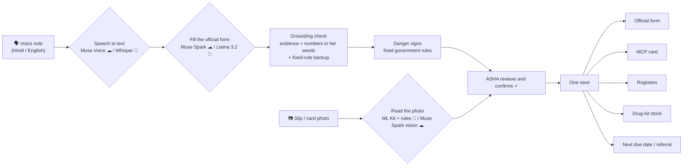
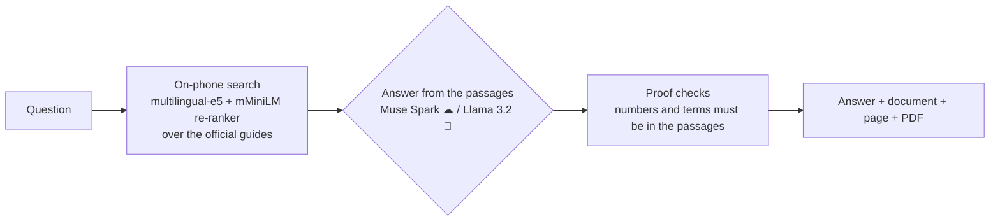

<p align="center">
  
</p>

<h1 align="center">Pramaan</h1>
<p align="center"><b>An offline AI co-worker for India's ASHA community health workers.</b><br>
One spoken visit note fills the official government forms, the Mother and Child Protection card and the registers —<br>
on an ordinary Android phone, in Hindi or English, <b>with or without internet</b>.</p>

<p align="center">
  
  
  
  
  
</p>

| | |
|---|---|
| 🎬 **Demo video (3 min)** | **DEMO_VIDEO_LINK** |
| 📱 **Download the app** | [**Pramaan v1.0 APK**](https://github.com/ektasikka1989-cmyk/Pramaan/releases/latest) (~700 MB — [why it is large](#why-the-apk-is-700-mb)) · [install in 3 steps](#try-it-in-10-minutes) |
| 🧠 **Models** | [MODELS.md](MODELS.md) · on-phone Meta models: [Pramaan_Meta_Models](https://huggingface.co/datasets/EktaSikka/Pramaan_Meta_Models) (3.3 GB, downloaded by the in-app setup) |
| 🏆 **Hackathon** | Meta Global AI Developer Hackathon 2026 · theme **Build for Your World** · [how Pramaan meets each judging criterion](#for-the-judges-criteria-and-where-to-see-them) |
| 👤 **Author** | Ekta Sikka |

> **Scope.** Pramaan is a job aid for trained government health workers, not medical advice for patients. Answers are
> retrieved from official government guides and cited to the page; danger signs and schedules are fixed rules from
> those guides; the ASHA approves every AI value before it is saved. All people in the demo are fictional.

---

## Contents
[The problem](#the-problem) · [What Pramaan does](#what-pramaan-does) · [The three demo workflows](#the-three-demo-workflows) ·
[For the judges](#for-the-judges-criteria-and-where-to-see-them) · [Meta models](#how-meta-models-power-pramaan) ·
[How it works](#how-it-works) · [Offline vs online](#what-works-offline-and-what-the-cloud-adds) ·
[Safety and privacy](#safety-privacy-and-clinical-responsibility) · [Try it](#try-it-in-10-minutes) ·
[Technical depth](#technical-depth) · [Built during the hackathon](#what-was-built-during-the-hackathon-26-oct--4-nov-2026) ·
[Build from source](#build-from-source) · [Honest status](#honest-status-and-limits) · [Licence](#licence-and-credits)

---

## The problem
India's community health system rests on about **one million ASHAs** (Accredited Social Health Activists). Each one
looks after roughly **1,000 people** in her village: every pregnancy, every newborn, every sick child.

For every home visit she must fill **a paper form, the family's MCP card, several registers and a drug-kit record** —
by hand, often where there is **no mobile signal**. The answers she needs ("which danger signs need urgent referral?",
"how do I make ORS at home?") are spread across **hundreds of pages of official training modules**. Paperwork takes
time away from care, and a missed danger sign or a skipped vaccine has real consequences.

Generic chatbots do not help her: they need internet, they do not know the government's forms, and they can make up
medical answers.

## What Pramaan does
| | |
|---|---|
| 🗣 **Speak once, every record updates** | One voice note in Hindi or English fills the **official** visit form (MCP card ANC / PNC / newborn, HBNC Annexure 9, HBYC, sick child, family planning). The same save updates the MCP card, the registers, the drug-kit stock and the next due date. Every value shows the words it came from. |
| 📚 **Ask the official guides** | Answers come only from government ASHA modules stored on the phone, with the **document and page**, a one-tap PDF and a "check online" option. Hindi, English and Hinglish questions. |
| 📷 **Read paper records** | Photograph a registration slip, a register page, the MCP card or a medicine strip: the details are read (on the phone, or by Meta Muse Spark online) and shown for the ASHA to confirm. Messy real-world photos are handled: tables without headings, names on two lines, tilted shots, OCR mistakes flagged ("Mobile has 9 digits — check it"), wrong documents rejected. |
| 🚨 **Danger signs by fixed rules** | Newborn, pregnancy, mother and sick-child danger signs come from the official guides as fixed rules — never from AI — and trigger a referral and a WhatsApp message to the ANM. |
| 💊 **Registers and drug kit** | Village, pregnancy (ANC), immunization and couple registers; stock register with low-stock alerts, refill requests, medicine-strip scanning and SAM 3.1 counting; monthly report and incentive estimate. |
| 🔒 **Her data stays hers** | Encrypted on the phone, with an encrypted backup to her own Google Drive. No government server, no third-party backend. |

## The three demo workflows
Home → **Demo** runs three complete, real ASHA visits. Every screen first shows its **aim**, then does the work live,
and after each action lists **what changed, with a button to open the real card, register or summary**.

| Workflow | What the judge sees |
|---|---|
| **1 · New pregnancy** (Sarita, 10 weeks) | Registration slip photo → added to the village and pregnancy registers (EDD by rule) → the right form opens (MCP card, ANC visit 1) → **one voice note fills 20 rows**: weight, height, pulse, BP, Hb, urine albumin and sugar, blood group, HIV test, Td-1, delivery hospital, complaints → danger check: none → ask the guides (pregnancy danger signs) → explanation for the family in Hindi → ASHA confirms → MCP card (pages 3–6), ANC register, stock (pregnancy test kit) and next due date update together |
| **2 · Newborn day-7 visit** (Baby of Neha) | MCP card photo: birth vaccines read with the ANM's dates → HBNC form Day 7 from a voice note → **danger sign: fever and poor feeding → refer** → WhatsApp to the ANM → ask the guides (cord care) → family advice → save: HBNC form, MCP card page 7 (linked), growth chart, referral, the mother's medicines from the kit |
| **3 · Sick child** (Rohan, diarrhoea) | Voice note → sick-child form → no danger sign, treat at home → ask the guides (ORS at home) → advice for the mother → ORS and zinc leave the kit → zinc runs out → refill request to the ANM → new strip scanned into stock (or the kit counted with SAM 3.1) |

## For the judges: criteria and where to see them
| What judges look for | How Pramaan answers it | Where to see it |
|---|---|---|
| **Impact** | A daily pain for about a million frontline health workers; works where they are — offline, on a basic phone, in Hindi; fills the **real government formats**, not new ones; danger signs never depend on AI | Video · [the problem](#the-problem) · Workflow 2 (referral) · [`docs/forms_verification.md`](docs/forms_verification.md) |
| **Creative use of Meta's AI** | **Four Meta models in one workflow**: Llama 3.2 on the phone for every AI step offline; Muse Spark (text and vision) for better answers and photo reading online; Muse Voice for Hindi/English notes; SAM 3.1 to count drug-kit items. One switch moves every AI action between phone and cloud, and **each answer is tagged with the model that produced it** | [Meta models](#how-meta-models-power-pramaan) · tap any ✨ tag in the app |
| **Demo** | Three end-to-end visits, each screen showing its aim, live AI, and links to the real records it changed; shown offline (airplane mode) and online | Video · Home → Demo |
| **Technical depth and execution** | llama.cpp on Android, on-device RAG with citations, grounded form filling with fixed-rule backup, table reading from OCR positions, privacy redaction of photos before upload, streaming model installer, 52 host test suites | [Technical depth](#technical-depth) · [`tools/host-tests/`](tools/host-tests) |
| **Theme: Build for Your World** | Built from first-hand knowledge of the ASHA's day: her forms, her registers, her village without signal | [The problem](#the-problem) |

## How Meta models power Pramaan
| Meta model | Where | What it does in the visit | Why this model | Code |
|---|---|---|---|---|
| **Llama 3.2 3B Instruct** (open weights, Q4_K_M) | **On the phone**, llama.cpp | Guide answers, voice note → official form, family explanation, ANM message, daily practice, reading slips when the rules need help — **all offline** | Small enough to run on a 6 GB phone, strong in Hindi and English, and lets the whole visit work with no signal | `LocalModelManager.kt`, `LlamaCppCore.kt`, `src/main/cpp/` |
| **Muse Spark 1.3** | Meta Model API | Better guide answers (grounded on the same passages), form filling, explanations, messages — when **Cloud first** is on, with an automatic fallback to the phone | Highest-quality answers when there is signal, checked by the same grounding rules as the phone's answers | `ArogyaVisitAi.route()`, `PocketRagEngine.kt`, `ArogyaModelClient.kt` |
| **Muse Spark 1.3 — vision** | Meta Model API | Reads whole photos like a person (handwriting, any layout) for slips, registers, MCP cards and medicine strips; also on demand via **"Read online"** when the phone's reading is incomplete. **Aadhaar is blacked out on the phone before sending** | Real paper records are messy; a vision model reads what OCR cannot | `ArogyaPhotoVision.kt`, `ArogyaPhotoText.kt` |
| **Muse Voice Transcribe** | Meta Model API | Hindi / English (and mixed) voice notes | Code-switched speech is how ASHAs actually talk | `ArogyaCloud.transcribe` → `MetaModelApi.kt` |
| **SAM 3.1** | Meta Model API | Counts drug-kit items (e.g. ORS sachets) from one photo; the ASHA confirms the count | Counting by segmentation instead of by hand | `SamCountDialog` in `ArogyaCloudUi.kt`, `ArogyaDemoTour.kt` |

**One setting, every AI action.** *Local first* uses the phone and the cloud only if the phone cannot; *Cloud first*
uses Meta's cloud models and falls back to the phone with no signal, a slow network (25 s limit) or a failed check.
The fallback is never silent: the answer's tag says, for example, *"✗ Muse Spark — tried, not used: no internet →
✨ Llama 3.2 on the phone"*.

## How it works




**Agentic, multi-step, with a human in the loop.** One note becomes: the right official form for that person and
visit → values with evidence → danger rules → referral and ANM message → card, registers, stock and next visit — with
grounding checks between steps and the ASHA's approval before anything is written.

## What works offline and what the cloud adds
| Feature | 📴 Offline (phone only) | ☁ Online (with a Meta key) |
|---|---|---|
| Visit forms from a voice note | ✅ Whisper + Llama 3.2 + fixed-rule backup | Muse Voice + Muse Spark |
| Answers from the official guides, with page | ✅ Llama 3.2 over on-phone search | Muse Spark on the same passages; online cross-check |
| Reading slips, cards, medicine strips | ✅ ML Kit + table rules + Llama 3.2 | Muse Spark vision reads the whole photo |
| Danger signs, schedules, stock, incentives | ✅ fixed government rules | same (never AI) |
| Registers, MCP card, PDF, WhatsApp text | ✅ | same |
| Drug-kit counting | by hand | SAM 3.1 |

## Safety, privacy and clinical responsibility
- **Grounded AI.** A form value is kept only if its evidence is in the ASHA's own words (or the document's text) and its numbers appear in that evidence. Guide answers must be supported by the retrieved passages. Nothing is invented: what could not be read is shown as "not captured".
- **The ASHA decides.** Every AI value is shown with its evidence and approved before it is saved. Doubtful values are flagged, never silently fixed.
- **Fixed rules for anything clinical-critical.** Danger signs, visit schedules, EDD and incentives come from the official guides as rules, not AI.
- **Clinically correct timing.** For example, the first-trimester visit records Td-1 and a pregnancy test, and does not give IFA or calcium before the second trimester, as the MCP card says.
- **Privacy by design.** Data is encrypted on the phone (AES-GCM, Android Keystore). Text sent to the cloud has names, relatives, village, phone, RCH ID and household removed. Photos go online only with Cloud first or when the ASHA presses "Read online", and **Aadhaar numbers are blacked out on the phone first**. Aadhaar is stored encrypted and shown masked (XXXX XXXX 1234).
- **No backend.** No government or third-party server; backup is an encrypted file in her own Google Drive. API keys are entered by the user, stored encrypted, and never in this repository.

## Try it in 10 minutes
**Phone:** Android 7.0+ (arm64), **6 GB RAM recommended**, about **7 GB free** during setup (about 4.5 GB after).

1. **Install** [Pramaan-v1.0-hackathon.apk](https://github.com/ektasikka1989-cmyk/Pramaan/releases/latest) (allow "install unknown apps").
2. **Open Pramaan — the setup wizard does the rest** (3 steps, each can be skipped, English or Hindi):
   1. **Offline AI models** — downloads the Meta models from Hugging Face (3.3 GB; Wi-Fi recommended; continues in the background; resumes after a dropped signal) and installs them. Already have the zip? Choose it from the phone.
   2. **Health guide** — installed from inside the app.
   3. **Meta AI key (optional)** — "Create a free key" opens [dev.meta.ai](https://dev.meta.ai/); paste it and tap **Test and save**.

   The last screen says plainly what works with what you installed. A yellow strip on Home offers **Finish setup** for any skipped step.
3. **Open Demo** and pick a workflow. Try it once in **airplane mode** and once with **Cloud first** — tap the ✨ tag on any answer to see which model produced it.

Test photos (slip, MCP card, medicine strips, ORS sachets) and the values each workflow expects: [`docs/TEST_PHOTO_PROMPTS.md`](docs/TEST_PHOTO_PROMPTS.md).

### Why the APK is ~700 MB
Pramaan is built to work **with no internet from the first minute**, so the APK carries its offline assets:
offline speech recognition (**Whisper**), the multilingual **search and re-ranking models** that find the right page in
the guides (English, Hindi, Hinglish), the **official guide database** with its embeddings, document templates, and
the native AI runtimes (llama.cpp, ONNX Runtime, ML Kit). Only the large Meta language model (3.3 GB) is downloaded
separately by the setup wizard, so it can be fetched on Wi-Fi.

## Technical depth
- **On-device LLM:** Llama 3.2 3B (Q4_K_M) through a llama.cpp JNI bridge with streaming, warm-up, cancellation and a context budget per feature (`LocalModelManager.kt`, `LlamaCppCore.kt`, `src/main/cpp/`).
- **On-device RAG with citations:** multilingual-e5-small embeddings + mMiniLMv2 cross-encoder re-ranking over a SQLite database built from official documents; answers carry document, page and a PDF link; numeric and term "proof" checks; 100 verified answers as a fallback layer.
- **One router for every AI action** (`ArogyaVisitAi.route()`): Local first / Cloud first, 25 s cloud deadline, network-loss detection, automatic phone fallback, and a recorded reason for every fallback.
- **Grounded form filling** (`ArogyaFormSpecs.kt`): only the form rows relevant to the note are sent, partial replies are rescued, and fixed rules fill vitals, medicines and danger signs (English and Hindi, clause-level negation) even with no model at all.
- **Reading real paper** (`ArogyaTableOcr.kt`): ML Kit word boxes → cells → rows → columns, headings in any wording or none at all, tilt-tolerant row fitting, merged-cell splitting, fuzzy category words, OCR digit fixes — tested against real OCR of a real photo.
- **Privacy before upload** (`ArogyaPhotoText.kt`): Aadhaar regions located from OCR boxes and blacked out on the bitmap before any cloud call.
- **Official documents as code:** the MCP card and visit forms rendered in their printed layouts, with linked saves (an HBNC Day-7 visit also fills MCP card page 7 for baby and mother).
- **Setup wizard:** Android DownloadManager (background, resume, Wi-Fi only), free-space checks, and a streaming zip installer that writes each model straight to its place.
- **Tests:** 52 pure-Kotlin host test suites (about 1,270 checks), including `AshaJourneyTest` (all three workflows end to end) and `RealLifeTest` (repeat visits, missed visits, danger signs said only in words, empty kit, backup and restore). See [`tools/host-tests/`](tools/host-tests).

## What was built during the hackathon (26 Oct – 4 Nov 2026)
**Existed before the event** (the author's own earlier work): the on-device LLM runtime (llama.cpp bridge and model
manager) and the RAG retrieval engine (guide search over a local database).

**Built during the event — the whole Pramaan app on top of them:**
- the ASHA workflow: visit planning from official schedules, the guided visit and the three demo workflows;
- voice note → official forms (MCP card ANC / PNC / baby care / immunization, HBNC Annexure 9, HBYC, sick child, family planning) with evidence and a fixed-rule backup;
- the official MCP card renderer and PDF output in the printed layouts;
- registers (village, pregnancy, immunization, couples, vital events), drug-kit stock register, refill requests, monthly report and incentive estimates;
- danger-sign rules, referral and the WhatsApp message to the ANM; family explanation; daily practice;
- photo features: people from slips and register pages, MCP card reading, medicine-strip scan, SAM 3.1 kit count; Muse Spark vision with Aadhaar redaction; "Read online"; wrong-document warnings;
- the single Local first / Cloud first router, Meta Model API integration (Muse Spark text and vision, Muse Voice Transcribe, SAM 3.1), model tags on every answer, identifier scrubbing, encrypted storage and Drive backup;
- the first-run setup wizard (Hugging Face downloads, Meta key), the Pramaan icon;
- RAG changes for Pramaan: citations to document and page with one-tap PDF, follow-up questions, Hindi/Hinglish queries, the verified-answers layer, proof checks and online cross-check;
- the guide database built from official documents, and the host test suites.

The git history starts on 1 Nov 2026: the first commit is a snapshot of the work from 26–31 Oct, and every later step
is its own commit. [`docs/batch_reports/`](docs/batch_reports) records each batch of work, what changed and how it was tested.

## Build from source
Requirements: Android Studio (compileSdk 36), JDK 17+, Android SDK 36, **NDK 26.1.10909125**, CMake (SDK Manager).

```bash
git clone https://github.com/ektasikka1989-cmyk/Pramaan.git
cd Pramaan
./gradlew :app:assembleDebug        # Windows: gradlew.bat :app:assembleDebug
adb install -r app/build/outputs/apk/debug/app-debug.apk
```

The large offline assets are **not in git** (GitHub's 100 MB file limit and their own licences); the released APK
contains them. To build an equivalent APK, place them under `app/src/main/assets/` — see [MODELS.md](MODELS.md):
`semantic/` (multilingual-e5-small, ONNX), `reranker/` (mMiniLMv2, ONNX), `voice/stt/whisper/model.bin` (Whisper).
The guide database, document templates and growth tables are in the repository.

**Tests** (no device needed): [`tools/host-tests/README.md`](tools/host-tests/README.md).

### Repository layout
```
app/src/main/java/com/example/arfas/
  Arogya*.kt            Pramaan's own code: visit flow, forms, registers, demo, AI routing, setup
                        (an earlier internal name is kept in file names on purpose)
  …                     the on-device AI platform: llama.cpp bridge, RAG, Whisper, OCR, Meta Model API client
app/src/main/cpp/       llama.cpp JNI bridge
whisper/, third_party/  whisper.cpp module (MIT)
app/src/main/assets/    guide database, document templates, growth tables
docs/                   product and code guide (HANDOVER), forms evidence, verified Q&A, benchmarks, reports
tools/                  host tests, icon script, demo photo generator, benchmark scripts
```
Developer guide: [`docs/HANDOVER.md`](docs/HANDOVER.md) · documentation index: [`docs/README.md`](docs/README.md).

## Official sources
- MCP Card (MoHFW / MoWCD), Handbook for ASHA Facilitators (Annexure 9 home-visit form), HBNC and HBYC guidelines, ASHA training modules — form evidence in [`docs/forms/`](docs/forms) and [`docs/forms_verification.md`](docs/forms_verification.md).
- Each guide answer cites its document and page. 100 verified questions and answers with a doctor review sheet: [`docs/verified_qa/`](docs/verified_qa).

## Honest status and limits
- Developed and tested on one arm64 Android phone during the hackathon; logic covered by the host tests.
- Llama 3.2 3B needs a phone with about 6 GB RAM; answers on the phone take seconds, not milliseconds.
- Handwriting that is hard to read offline is flagged for the ASHA to type or to read online with Muse Spark.
- Benchmarks and what is not yet measured: [`docs/benchmark/final.md`](docs/benchmark/final.md). Known gaps: [`docs/GAP_ANALYSIS.md`](docs/GAP_ANALYSIS.md).
- **Next:** a pilot with ASHAs and their ANM, more state-specific registers, a smaller APK variant, and integration hooks for the government's RCH portal export format.

## Licence and credits
- Pramaan's code: **MIT** — [`LICENSE`](LICENSE).
- **Built with Llama.** Llama 3.2 is licensed under the [Llama 3.2 Community License](https://www.llama.com/llama3_2/license/), Copyright © Meta Platforms, Inc. All Rights Reserved.
- Meta Muse Spark, Muse Voice Transcribe and SAM 3.1 are used through the Meta Model API with the user's own key.
- whisper.cpp / Whisper: MIT · ONNX Runtime: MIT · Sherpa-ONNX: Apache-2.0 · multilingual-e5-small: MIT · mMiniLMv2 re-ranker: Apache-2.0 · Google ML Kit: Google's terms.
- Official guides and forms: Government of India (MoHFW / NHM / NHSRC); cited, not modified.
