<p align="center">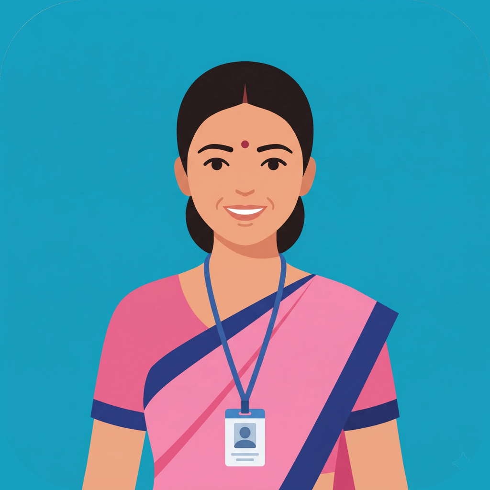</p>

<h1 align="center">Pramaan</h1>

<p align="center"><strong>An offline-first AI co-worker for India's ASHA community health workers.</strong><br>
Ask an official SOP. See the exact source and page. Turn a home visit into accountable follow-up — even without a mobile signal.</p>

<p align="center">
  
  
  
  
  
</p>

> **Hackathon prototype — fictional records only.** Pramaan supports trained frontline workers; it is not a diagnostic device, does not replace clinical judgment, and is not approved for live patient records. The demo people and records are synthetic.

| Explore | Link or status |
|---|---|
| 🎬 **Three-minute demo** | **Coming soon — video in production** |
| 📱 **Android APK** | [GitHub Releases — download APK](https://github.com/ektasikka1989-cmyk/Pramaan/releases) (~700 MB) · [install and test](#try-the-prototype) |
| 📚 **Models and setup** | [MODELS.md](MODELS.md) · **[Model pack, primary link](https://pub-c8d63c87f3ff45c6919a4bdeb91cb247.r2.dev/Pramaan_Meta_Models.zip)** · [Model pack, standby link](https://huggingface.co/datasets/EktaSikka/Pramaan_Meta_Models/resolve/main/Pramaan_Meta_Models.zip?download=true) (approximately 3.3 GB) |
| 🔒 **Data handling** | [PRIVACY.md](PRIVACY.md) — what is stored, what leaves the phone and when |
| 🏆 **Entry** | Meta Global AI Developer Hackathon 2026 · Build for Your World · Ekta Sikka |

## The problem: one frontline worker, hundreds of decisions

India's National Health Mission relies on about **ten lakh (one million) ASHAs** (Accredited Social Health Activists). The commonly cited planning norm is approximately **one ASHA per 1,000 rural residents**, although actual workloads vary: she tracks every pregnancy, newborn and young child in her area and connects families to the ANM and the health centre. For families depending on her, a missed immunisation follow-up, an unrecorded pregnancy visit or a delayed referral can matter. Across lakhs of workers, small improvements in everyday work could benefit **many lakhs of people**; this is the potential reach, **not a measured outcome** of Pramaan.

Her challenge is not simply answering a medical question:

1. **Guidelines keep growing and changing.** ASHAs work with hundreds of pages of training modules, SOPs, programme instructions and updates, often in different languages. Finding the applicable paragraph during a visit is difficult; checking whether an action agrees with it is harder.
2. **Work is fragmented.** A single home visit can involve a paper visit form, the family's MCP card, multiple registers, stock records and future appointments. Duplicate writing makes missed entries and follow-ups more likely.
3. **The family needs an explanation.** The worker must convert technical guidance into understandable Hindi or another local language, while making clear when a clinician or ANM is needed.
4. **Handoffs need evidence and accountability.** An ANM or PHC needs a usable summary of what was observed, done, referred and left pending — not a disconnected pile of notes. A record of completed and due actions helps the worker review her own work too.
5. **Connectivity cannot be assumed.** In a village without a signal, a cloud-only chatbot cannot reliably support a visit.

**Pramaan's answer:** a source-citing **Ask SOP** assistant connected to a visit workflow, rather than a general chatbot — an **accountable fieldwork co-worker**. It helps the ASHA find guidance, inspect the evidence, capture a visit, review suggested entries, update records, track pending work, and prepare a summary for the ANM or PHC. The worker remains responsible for confirmation and escalation.

## How Pramaan helps

| | |
|---|---|
| 🗣 **Speak once, records update together** | One voice note (Hindi, English or mixed) fills the visit form for that person and visit — MCP card ANC / PNC / newborn pages, HBNC home visit (Annexure 9), HBYC, sick child, family planning. One confirmed save updates the MCP card, registers, drug-kit stock and next due date. Each value shows the words it came from. |
| 📚 **Answers from the official guides** | Questions are answered from government ASHA modules stored on the phone, with the document, page and a one-tap PDF. |
| 📷 **Paper records to digital** | Photos of a registration slip, register page, MCP card or medicine strip are read and shown for confirmation. Doubtful values are flagged ("Mobile has 9 digits — check it"), unreadable fields are listed, and unrelated photos are reported as the wrong document. |
| 🚨 **Danger signs by fixed rules** | Newborn, pregnancy, mother and sick-child danger signs are checked by rules taken from the official guides (not by an AI model), leading to a referral and a ready WhatsApp message for the ANM. |
| 💊 **Registers and drug kit** | Village, pregnancy (ANC), immunization and couple registers; stock register with low-stock alerts, refill request, medicine-strip scan and SAM 3.1 counting; monthly summary. |

## The signature feature: Ask SOP — guidance with proof

Ask a question in **Hindi, English or Hinglish** — for example, *“What newborn danger signs require urgent referral?”* Pramaan searches its locally stored government-guide knowledge base and presents:

- a concise, task-relevant response drawn from the **local knowledge base of 68 official documents** (5,389 passages) stored on the phone;
- the **source document, specific page and supporting passage** so the ASHA can check what the guidance actually says;
- access to the underlying PDF when available, highlighted supporting passages showing the exact sentences the answer came from, plus follow-up questions;
- an optional **Check online** route for eligible cloud use, clearly distinguished from the offline source answer.

This is more than a citation pasted beneath an AI reply: the intended workflow is **ask → inspect source → decide with professional judgment → record action → review follow-up**. A citation makes verification possible; it **does not guarantee that an answer is clinically correct**. Current local content must be updated when official guidance changes.

### The 68-document official-guidance knowledge base

Pramaan's demonstration knowledge base contains **68 official health-worker reference documents** as displayed in the app. The documents are indexed locally for retrieval. The **Ask SOP** workflow searches relevant passages, re-ranks evidence, generates an answer with **Meta Llama 3.2 3B** offline, and displays the **specific document, page and supporting excerpt**, with the underlying document available to open. Source traceability is the central design feature: the worker can verify what a guideline says even without mobile data. The document collection is a prototype snapshot and should not be mistaken for a guarantee that all official guidance is current.

## See Pramaan working on a real Android phone

Screenshots below are from the working prototype, using fictional demonstration records. The most distinctive capability is **Ask SOP: an offline answer with an inspectable official document, page number, highlighted supporting passage and a button to open the source PDF.** This allows the ASHA to check the evidence rather than trusting a free-standing AI answer.

| ASHA dashboard: due and overdue visits | Household and patient records |
|---|---|
| 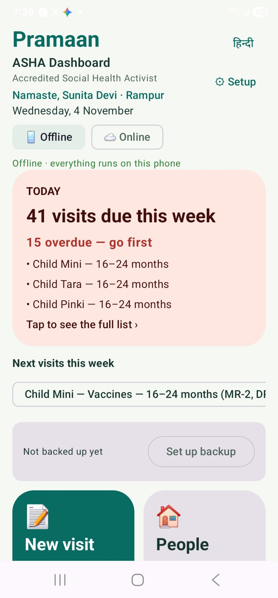 | 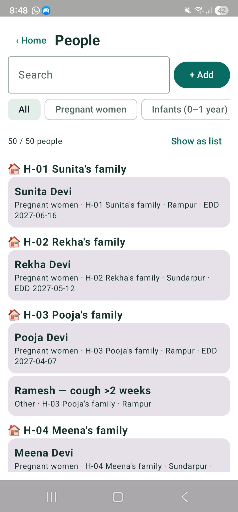 |

### Ask SOP — answer, page citation and highlighted original passage

The demonstration asks *“What should be applied on the baby's cord stump?”* The local model creates a structured answer, then shows the retrieved evidence including **Integrated ASHA Training Module — Part B, p.18** and a second official source. Opening the citation reveals the exact highlighted lines. The user can inspect the original PDF.

| Ask the question | Offline answer and named source | Highlighted passage from the official guide |
|---|---|---|
| 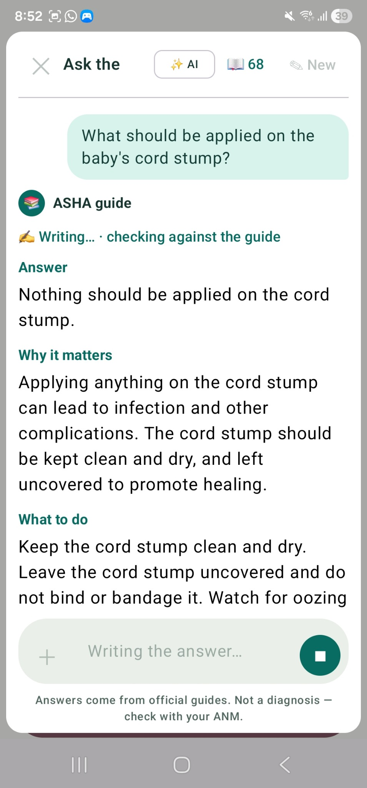 | 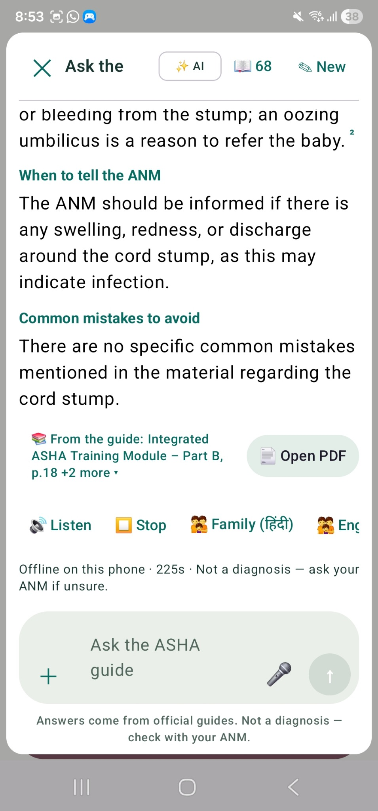 | 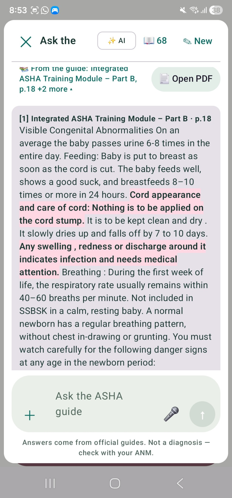 |

Additional retrieved evidence is visible in the [second-source screenshot](docs/screenshots/06-second-source.jpg).
**Citations support verification; they do not guarantee that every generated statement is correct.** The ASHA must review the guidance and escalate concerning findings to the appropriate health professional.

| Offline MCP card, exportable as PDF | One-time model setup, with manual ZIP import |
|---|---|
| 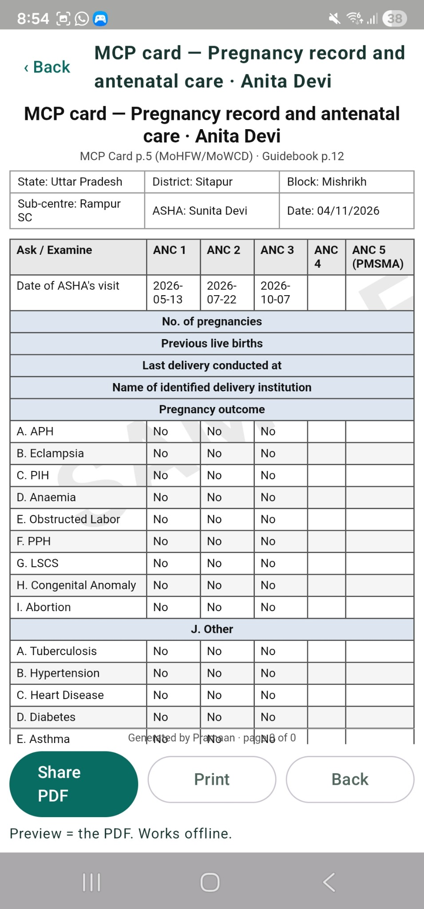 | 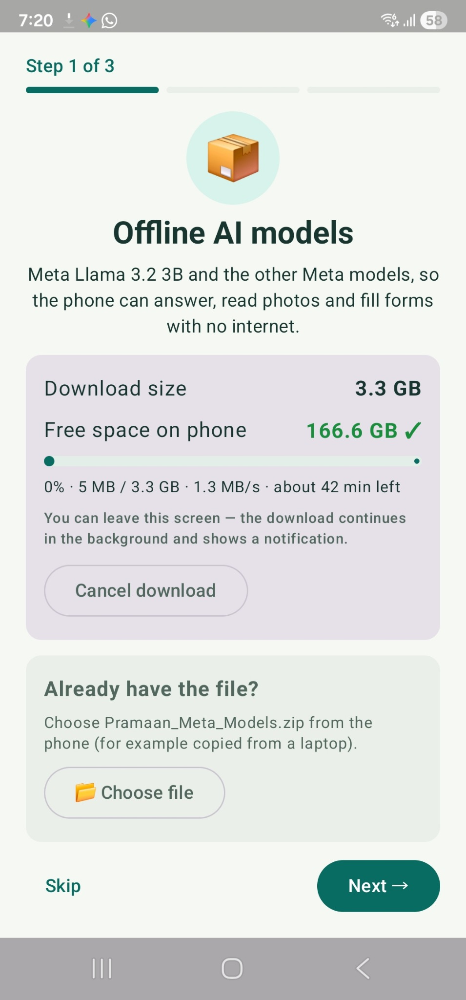 |

| Feature-to-model explanation inside the app | Illustrative task timings |
|---|---|
| 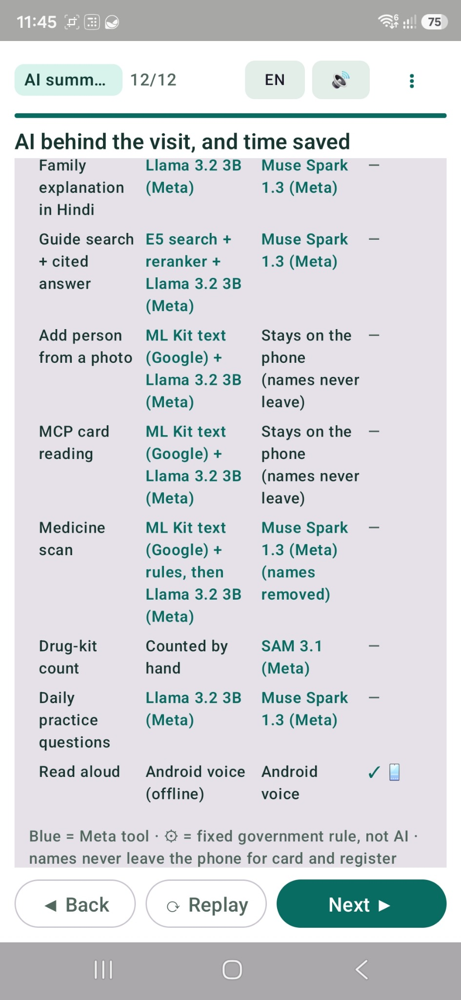 | 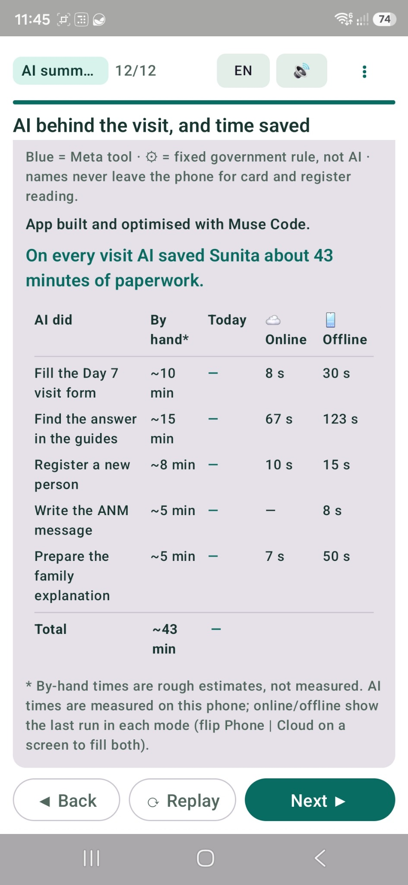 |

The in-app manual timings are **estimates**, not controlled measurements of time saved. App timings are example runs on one device; they are not performance guarantees.

## From one visit to an accountable workflow

| At the doorstep | What Pramaan helps do | What stays traceable |
|---|---|---|
| **Plan** | See due ANC, HBNC, HBYC, immunisation and missed visits | Person, visit type, due date, pending tasks |
| **Capture** | Speak a Hindi/English note; read a slip or MCP card photo; suggest fields for the relevant form | Proposed values and their supporting note or extracted text |
| **Verify** | Ask SOP with document/page citation; review fixed-rule danger-sign prompts | Source reference, worker review, referral decision |
| **Explain** | Prepare family-friendly instructions in accessible language | Guidance the worker chooses to communicate |
| **Record** | Confirm and save to linked visit forms, digital MCP-card sections, registers and drug-kit stock | Completed entries, quantities and next due date |
| **Coordinate** | Prepare a referral or visit summary for an **ANM/PHC**, including a WhatsApp message where applicable | A shareable handoff; **sending is user-controlled**, not automatic government-system integration |
| **Follow up** | Review upcoming visits, unresolved referrals, stock shortages, refill requests and monthly summaries | What is done, due, or still needs attention |

Pramaan includes document-based adaptations and application-specific fields. It is **not an officially endorsed government record system**. See the [form-by-form comparison](docs/forms_verification.md).

## Three connected demonstration journeys

The built-in **Home → Demo** presents fictional end-to-end examples. Each journey should be tested on the released APK before being described as fully verified on-device. Each screen shows its aim, runs the step live, and after every action lists what changed, with a button to open the real card, register, stock register or visit summary.

| Scenario | Journey and outcome |
|---|---|
| **Pregnancy — Sarita, 10 weeks** | Read a registration slip → create village/pregnancy entries → capture ANC observations by voice → review suggested MCP/ANC fields → **Ask SOP** about pregnancy danger signs with a cited page → prepare a family explanation → confirm the record and next visit. |
| **Newborn — Baby of Neha, day 7** | Read the MCP card → capture an HBNC visit → flag reported fever/poor feeding for urgent assessment → consult the cited newborn guide → prepare an ANM referral message → review linked HBNC, MCP and follow-up entries. |
| **Sick child — Rohan, diarrhoea** | Capture symptoms → check danger signs and the relevant SOP → explain ORS guidance from the source → record worker-confirmed ORS/zinc stock usage where appropriate → trigger low-stock/refill workflow. |

Other supported workflow areas include family planning, routine immunisation tracking, child growth records, village and pregnancy registers, repeat/missed visits, paper-to-digital OCR, medicine-strip scanning, stock counting, monthly reports, incentive estimates and daily practice. Feature behaviour and limitations are documented in the [handover](docs/HANDOVER.md) and [known gaps](docs/GAP_ANALYSIS.md).

## Meta models make this practical

Pramaan combines **on-device Meta Llama** with the **new Meta Model API models**, using each for a different part of the ASHA's work.

| Model | Role | Connectivity |
|---|---|---|
| **Llama 3.2 3B Instruct (quantised)** | Locally grounded answers over retrieved SOP passages, draft form fields, family explanations and referral text | **On phone**, after one-time model installation |
| **Muse Spark 1.3** | Optional cloud reasoning and writing over the same retrieved evidence; also a vision route for difficult photographed documents | **Online**, with a working Meta Model API key |
| **Muse Voice Transcribe** | Optional Hindi/English or mixed-language speech transcription | **Online**, with a working key |
| **SAM 3.1** | Optional object segmentation/counting for photographed drug-kit items, subject to worker confirmation | **Online**, with a working key |
| **Muse Code** | Agentic coding assistant used to build Pramaan (development tool, not a runtime model) | **Dev-time** |

The app also uses **Whisper** for local speech recognition, **ML Kit** for local OCR, and **Android TextToSpeech** for reading aloud, and local search/re-ranking models to retrieve SOP passages. These are supporting components, not all Meta models. **Local first** and **Cloud first** selection, fallback indicators and actual cloud availability must be verified in the installed build. Offline capability refers to functionality **after the required local model/guide setup**; it is not a claim that every feature works before setup.

### How Meta models are used

| Meta model | Where it runs | Role in the visit | Code |
|---|---|---|---|
| **Llama 3.2 3B Instruct** (open weights, Q4_K_M) | On the phone (llama.cpp) | Answers from the guides, voice note → form, explanations, ANM message, daily practice, help reading slips — without internet | `LocalModelManager.kt`, `LlamaCppCore.kt`, `src/main/cpp/` |
| **Muse Spark 1.3** | Meta Model API | The same tasks with higher quality when Cloud first is on, checked by the same grounding rules | `ArogyaVisitAi.route()`, `PocketRagEngine.kt` |
| **Muse Spark 1.3 — vision** | Meta Model API | Reads whole photos (handwriting, any layout); Aadhaar numbers found on the phone are blacked out before sending | `ArogyaPhotoVision.kt`, `ArogyaPhotoText.kt` |
| **Muse Voice Transcribe** | Meta Model API | Hindi / English / mixed voice notes | `ArogyaCloud.transcribe`, `MetaModelApi.kt` |
| **SAM 3.1** | Meta Model API | Counts drug-kit items from a photo; the ASHA confirms the count | `SamCountDialog` (`ArogyaCloudUi.kt`) |

**One setting for every AI step.** *Local first* uses the phone and the cloud only if the phone cannot answer; photos and audio never go online by themselves. *Cloud first* uses Meta's models and falls back to the phone with no signal, after 25 seconds, or if an answer fails its checks. The fallback is shown on the answer's label, for example *"Muse Spark — not used: no internet → Llama 3.2 on the phone"*.

### Feature-to-AI model map: offline and online

**Meta technologies are highlighted in bold.** The table differentiates AI generation, document search, conventional OCR, Android services and fixed government-derived rules. Cloud features require a configured service and internet.

| Feature | 📴 On the phone | ☁ Online / cloud |
|---|---|---|
| Speech to text | Whisper | **Meta Muse Voice Transcribe** |
| Visit form from a voice note | Whisper + **Meta Llama 3.2 3B** + fixed-rule backup | **Meta Muse Voice** + **Meta Muse Spark 1.3** |
| **Ask SOP: guide search, cited answer and original PDF** | Multilingual E5 retrieval + reranker + **Meta Llama 3.2 3B** | Retrieved official passages + **Meta Muse Spark 1.3** |
| ANM message draft and family explanation | **Meta Llama 3.2 3B** | **Meta Muse Spark 1.3** |
| Reading slips and MCP cards | Google ML Kit + rules + **Meta Llama 3.2 3B** | Sensitive identifiers stay local for applicable workflows |
| Reading medicine strips | Google ML Kit + rules + **Meta Llama 3.2 3B** | **Meta Muse Spark 1.3** where configured |
| Danger signs, schedules, stock, incentives | Fixed rules | Same (never AI) |
| Registers, MCP card, PDF, WhatsApp text | ✅ | ✅ |
| Drug-kit counting | By hand | **Meta SAM 3.1** when configured |
| Daily learning and practice | **Meta Llama 3.2 3B** | **Meta Muse Spark 1.3** |
| Read answers aloud | Android TextToSpeech | Android TextToSpeech |

The application was developed and refined with **Meta Muse Code**. Model names describe the app's intended integrated paths; availability of online features depends on API credentials and service access.

### How long does a response take?

**Offline answers on the phone typically take 1–3 minutes, sometimes longer depending on the device and question.** One Ask SOP example took **225 seconds** (3 min 45 sec). **Cloud responses are generally faster when connected**, but speed varies with network and service conditions. Rule-based schedules, record viewing and PDF operations do not necessarily incur LLM generation time.

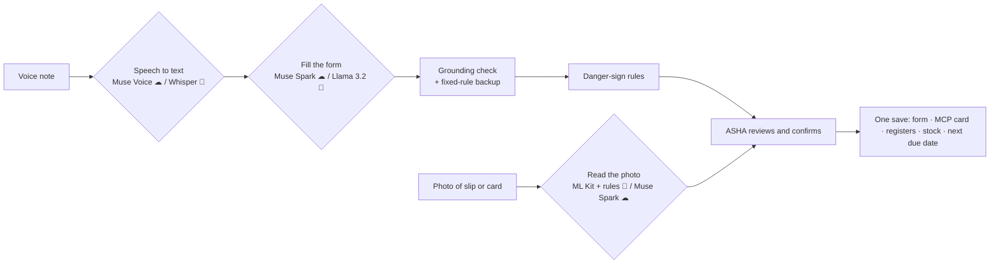

## Why offline changes the situation

In a no-signal area, the worker should still be able to **find locally installed guidance and citations, capture the visit, review records, see due work and prepare the next action**. This does not eliminate the need for clinical referral or connectivity when a message must be sent. Offline records are not silently synchronised with any government portal.

## A platform that could also serve ANMs

The same architecture — **role-specific knowledge base + cited guidance + forms + schedules + accountable handoffs** — could be adapted for **Auxiliary Nurse Midwives (ANMs)** and other frontline roles. An ANM version would need **more than swapping PDFs**: its own validated knowledge base, scope-of-practice rules, workflows, permissions, forms, training and clinical/privacy review. This is a **future extension**, not a completed ANM deployment.

## Safety, privacy and responsible use

- **Human review:** AI-generated form values are suggestions. The ASHA must verify source text, captured observations and actions before saving. Doubtful values are flagged, never silently corrected.
- **Grounding:** a form value is kept only if its evidence is in the ASHA's words (or the document's text) and its numbers appear in that evidence; fixed rules fill vitals and medicines the model misses. Guide answers are checked against the retrieved passages. Fields that could not be read are shown as "not captured" rather than guessed.
- **Clinical boundaries:** Rule-based danger-sign prompts can miss information not captured in a note. They do not replace examination, judgement or urgent referral protocols. Clinical content has not been independently reviewed by a clinician for this prototype.
- **Source boundaries:** Retrieved government material may be old or incomplete; cited pages allow inspection but do not establish current approval.
- **Fictional-data prototype:** Do not enter identifiable real patient information in this hackathon build.
- **Cloud disclosure:** If enabled, Meta Model API may receive selected text, audio, images and retrieved passages. Identifier filtering and photo redaction are risk-reduction mechanisms, **not guarantees of anonymity**. See [PRIVACY.md](PRIVACY.md).
- **Records stay on the phone**, encrypted, with an optional password-protected backup file the ASHA saves where she chooses.
- **No official integration claimed:** ANM/PHC handoff is a worker-controlled summary/message, not direct write access to RCH or government systems.

## Try the prototype

**Phone:** Android 7.0+ (arm64), about **6 GB RAM** recommended, about **7 GB free** during setup (about 4.5 GB after).

1. **Install the APK:** download the latest APK from [GitHub Releases](https://github.com/ektasikka1989-cmyk/Pramaan/releases), open it on the phone and allow installation ("install unknown apps"). Verify the installed build on-device before relying on it.
2. **Setup:** Install the offline model pack and guide database through the in-app setup flow (model pack: the **primary Cloudflare R2 link** is tried first, the **Hugging Face standby link** only if it fails — see above). A Meta Model API key is optional for online model features; availability and billing are determined by Meta. The setup wizard has three steps, each of which can be skipped: offline AI models (~3.3 GB, Wi-Fi recommended, or choose a ZIP already on the phone), health guide (installed from inside the app), and Meta API key ("Create a key" opens [dev.meta.ai](https://dev.meta.ai/); paste and tap **Test and save**). After installation, grant microphone access for voice input and test speech playback — **Android does not require a separate speaker permission**.
3. **Demo:** Open **Home → Demo** with fictional data. First test installed local guidance and an Ask SOP citation in airplane mode; then test any configured cloud pathway separately. Tap the ✨ label on any answer to see which model produced it.
4. **Proof:** Check the cited PDF/page, confirm changes in the linked record and inspect the pending visit/referral/stock summary.

For sample input images and expectations, see [synthetic test-photo prompts](docs/TEST_PHOTO_PROMPTS.md). Performance measurements and remaining gaps are in [benchmark notes](docs/benchmark/final.md) and [GAP_ANALYSIS.md](docs/GAP_ANALYSIS.md).

**Why the APK is ~700 MB:** it carries the assets that let the app work offline — speech recognition (Whisper), the multilingual search and re-ranking models that find the right page in the guides, the official guide database and the native AI runtimes (llama.cpp, ONNX Runtime, ML Kit). Only the 3.3 GB language model pack is downloaded separately, so it can be fetched on Wi-Fi.

## Architecture, testing and source

- Android application with llama.cpp on-device inference, Whisper speech-to-text, ML Kit OCR, SQLite-based guide retrieval, multilingual embeddings/re-ranking, rule-backed forms and optional Meta Model API calls.
- One router for every AI action (`ArogyaVisitAi.route()`): Local first / Cloud first, time limits, automatic fallback with a recorded reason.
- Setup uses Android DownloadManager (background, resume, Wi-Fi only) and a streaming zip installer.
- The repository includes [form verification](docs/forms_verification.md), [verified-QA material](docs/verified_qa/), [host tests](tools/host-tests/) and a [developer handover](docs/HANDOVER.md). Host-test results do **not** prove complete Android or clinical validation.
- The supplied source may require separately licensed, large local assets to produce an equivalent APK; see [MODELS.md](MODELS.md).

```
app/src/main/java/com/example/arfas/   Arogya*.kt = Pramaan's code; the rest = on-device AI platform (llama.cpp, RAG, Whisper, OCR, Meta API)
app/src/main/cpp/                      llama.cpp JNI bridge
app/src/main/assets/                   guide database, document templates, growth tables
docs/                                  product and code guide (HANDOVER), forms evidence, verified Q&A, benchmarks
tools/                                 host tests, icon script, demo photo generator
```

Developer guide: [`docs/HANDOVER.md`](docs/HANDOVER.md) · documentation index: [`docs/README.md`](docs/README.md).

```bash
git clone https://github.com/ektasikka1989-cmyk/Pramaan.git
cd Pramaan
./gradlew :app:assembleDebug
```

Requirements and detailed build guidance: Android Studio, Android SDK 36, JDK 17, NDK 26.1.10909125 and CMake; see the [handover](docs/HANDOVER.md). Build success should be confirmed in the target environment.

## What is new for the hackathon

The author's prior work included the local inference and retrieval foundations (the on-device LLM runtime and the retrieval engine). During the 26 October–4 November 2026 hackathon period, Pramaan was built around those foundations with ASHA-oriented visit planning; linked forms/MCP/registers; the Ask SOP citation experience; speech and photo capture; danger-sign and follow-up rules; stock/referral/report workflows; the Local/Cloud routing layer; Meta model integrations; setup and tests. [Development batch reports](docs/batch_reports/) document the work. The first public Git commit is a later snapshot, not proof by itself of the original development date.

## Sources, credits and status

Content is drawn from ASHA/NHM/MoHFW and related official publications; see [forms evidence](docs/forms_verification.md) and the source information supplied in the guide database. Each guide answer cites its document and page. The documentation may not be the latest version for every programme or state. Pramaan is not affiliated with or endorsed by MoHFW, NHM, or Meta.

Pramaan application code: [MIT License](LICENSE), subject to third-party notices. **Built with Llama.** Llama 3.2 has a separate [Meta Llama Community License](https://www.llama.com/llama3_2/license/), Copyright © Meta Platforms, Inc. Other components and model weights retain their respective licences (whisper.cpp / Whisper: MIT · ONNX Runtime: MIT · Sherpa-ONNX: Apache-2.0 · multilingual-e5-small: MIT · mMiniLMv2 re-ranker: Apache-2.0 · Google ML Kit: Google's terms); see [MODELS.md](MODELS.md). **Current status:** prototype; expanded field, accessibility, clinical and privacy validation are future work.
